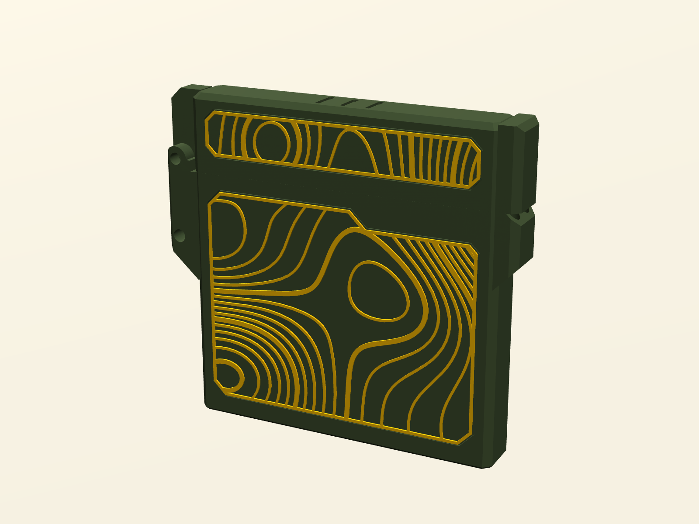
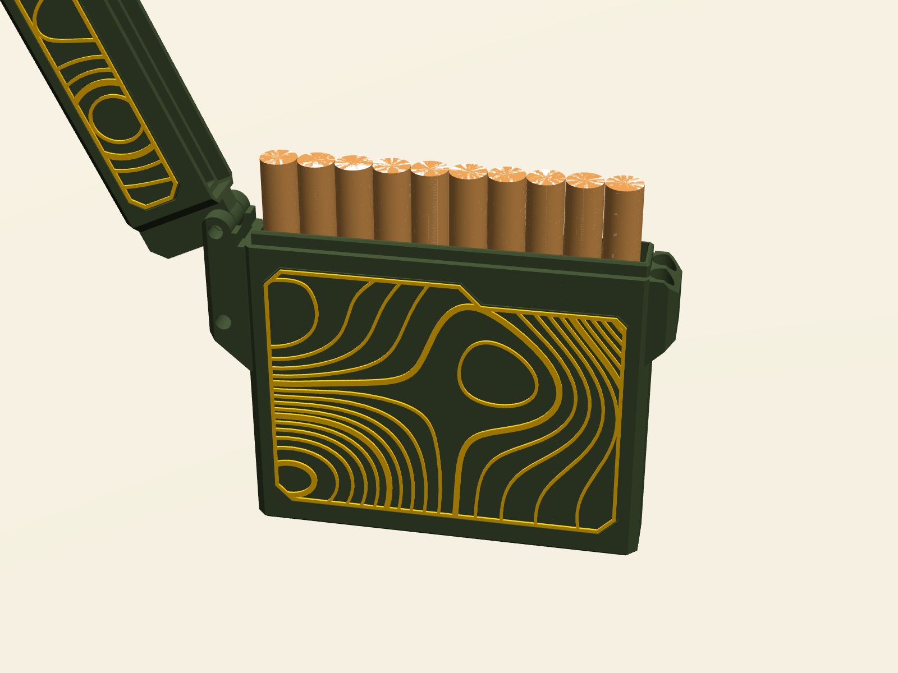

# Slim EDC Cigarette Case: Topo Edition

A slim pocket case for **10 king-size cigarettes** (85 × 8 mm). It borrows the design language of JanBerry Design's *Hiking Container*: a faceted chamfered shell, a screw-pin side hinge on lug fins, a latch block on the opposite side, recessed front panels with an angular step, and a lanyard hole. The geometry is all new. No meshes were copied from the original.

## Specs

| | |
|---|---|
| Outer size | 87 × 14.2 × 90.4 mm shell (100.4 mm wide including hinge fin and latch block) |
| Capacity | 10 × king size, standing 18 mm proud for an easy grab |
| Weight | about 65 g in PLA (shell about 49 g, inserts about 17 g) |
| Lid swing | 0–142° with no collisions (checked in 3D against the body and a full load); natural stop at about 143° |
| Supports | None needed |

## Files

- `EDC_Cigarette_Case_Topo.3mf`: Bambu Studio project with 2 plates.
  - **Plate 1, shell (green only):** the body prints upright and the lid prints upside down.
  - **Plate 2, topo inserts (green + yellow):** 4 inserts printed flat and face up. Each one is a green 1.2 mm base plus yellow lines raised 0.5 mm. That needs only **one colour change**, at the 1.2 mm layer, so a printer without an AMS can do it with a pause/filament change.
- `stl/`: the same parts as loose STLs.
- `src/case.py`: the parametric generator. Change `N_CIG`, `CIG_D`, `CIG_L`, `STICK` (for example `CIG_L = 100` for 100s, or `N_CIG = 8` for a narrower case), then run `src/export.py <outdir> <original_3mf_extracted_dir>`.

## Hardware

- 1 × **M3 × 14 socket-head cap screw** (hinge pin). It passes through the front lug and self-taps into the 2.5 mm hole in the back lug. A length of 1.75 mm filament can stand in, but the screw is better.
- 4 × **5 × 3 mm N52 disc magnets**: 2 in the body latch block and 2 in the lid. Glue them in with CA glue and **check the polarity before the glue sets**.
- CA glue or thin double-sided tape for the inserts. The pockets have 0.15 mm clearance per side.

## Print settings (already set in the 3MF)

0.16 mm layers, 4 walls, 25% infill, no supports, 0.4 mm nozzle. Filament 1 is dark forest green (#3B4A2F), filament 2 is signal yellow (#F2B705).

**Material:** matte PLA looks best. For a pocket and car-dashboard EDC item, though, **PETG or ASA** will not creep or warp in heat. Use those for the shell if it will live in a car.
