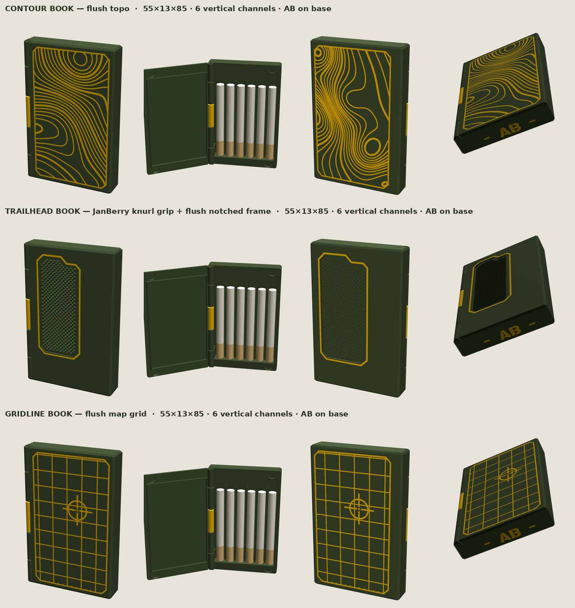

# Rollie Book Case v4: 55 × 13 × 85 mm

A clamshell hinged on its long edge (the spine) for roll-ups up to **6 mm wide and 60 mm long**. It holds **6** in vertical channels: ribs on the inside of the tray back hold each one upright.

## Bambu Studio projects (pick one)
| File | Surface |
|---|---|
| `Contour_Book_55x13x85.3mf` | Flush yellow contour lines on the front and back |
| `Trailhead_Book_55x13x85.3mf` | JanBerry-style pyramid grip texture (points level with the face) inside a flush yellow notched frame |
| `Gridline_Book_55x13x85.3mf` | Flush yellow map grid with crosshair |

Every version has a flush yellow **AB** on the bottom edge.

## What the file contains
- **1 plate, no supports.** The tray prints back-down and the cover face-down, so the decorated faces print against the bed and come out flush and crisp. The yellow spine sleeve prints standing on end.
- **Filament 1 (green, #3B4A2F):** the shell. **Filament 2 (yellow, #F2B705):** the inlays and the sleeve. An AMS (or AMS Lite) is assumed.
- **Infill:** each object is set to 4 walls and 50% gyroid. Modifier volumes force **100% infill and 6 walls** on the hinge barrel and the magnet end blocks.
- **Layer height:** 0.16 mm. The bed-face inlays take about 4 layers of colour changes per part.
- **The AB lettering** stands vertical in print orientation, so it costs about 35 extra colour changes, roughly 20–30 minutes and a few grams of purge. Set "Flush into objects' infill" to cut the waste.

## Hardware
- **Hinge pin:** 1 × 2 mm steel or stainless rod, 83 mm long. The hole is blind at the bottom. Slide the rod in from the top and seal it with a drop of CA glue.
- **Magnets:** 4 × 6 × 2 mm N52 discs, glued into the end blocks of the tray and cover. **Check the polarity before the glue sets.**
- **Spine sleeve:** the yellow sleeve threads onto the pin between the cover knuckles and spins freely.

## Checks done
- 3D: no overlaps when closed, 6 roll-ups clear of the ribs, and the cover swings to about 165° without touching anything.
- Not yet test-printed. The gaps (0.3 mm hinge, 0.15 mm lip) are standard values.

## Material
- **PETG-HF or ASA** for pocket and car use.
- **PLA Matte** if hand-feel matters more than heat resistance.
