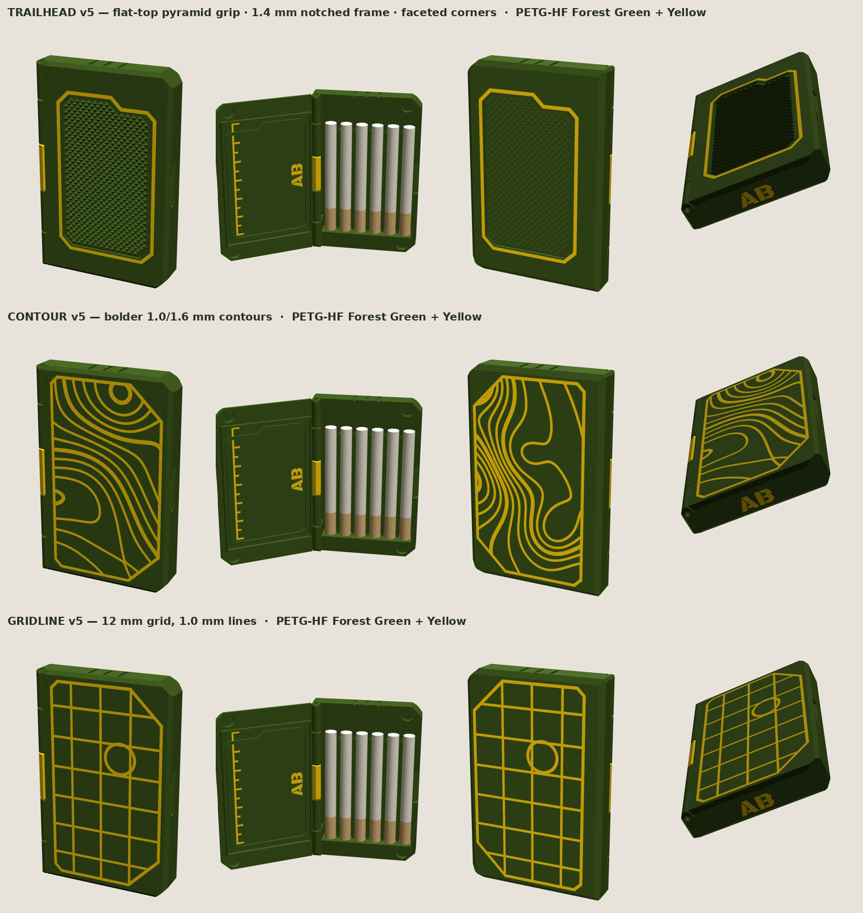

# Rollie Book Case v5: 55 × 13 × 85 mm (current)

This is the review-driven revision of v4. It uses the findings of a research agent, an independent industrial-design critique and the integrated-review method from `industrial-product-design-gbt`.

## Bambu Studio projects
| File | Finish |
|---|---|
| **`Trailhead_Book_55x13x85.3mf`** (recommended) | Flat-top pyramid grip + 1.4 mm yellow notched frame |
| `Contour_Book_55x13x85.3mf` | Bolder flush contour lines |
| `Gridline_Book_55x13x85.3mf` | 12 mm flush map grid + waypoint ring |

Every version has the flush **AB** on the bottom and, inside the cover, a raised stiffening frame, a 60 mm ruler and a mirrored AB.

## What changed from v4
- **Fixed** the Trailhead panel, which was built from mixed-up coordinates (24 mm wide instead of 40).
- **Fixed** the magnet pockets, which had a 0.15 mm wall. The end blocks are now 8.5 mm, giving 1.1 mm walls.
- **Octagonal silhouette:** 5 mm × 45° corners on the opening side; chamfers of 1.5 mm on the front edges, 2.0 on the back and 1.0 at top and bottom.
- **Yellow lines** are at least 1.0 mm wide (frames 1.4–1.6) and kept at least 0.8 mm from the magnets.
- **Grip pyramids** have flat tops (0.6 mm), so they print on the bed and feel less sharp.
- **Rollie channels:** 6 × 6.8 mm slots with 1.2 mm ribs, for rollies up to 6 mm.
- **Hinge:**
  - Tray knuckles Ø1.95 (tight press fit; ream with a 2.0 mm drill); cover knuckles Ø2.2 (slip fit); teardrop-shaped bores.
  - The 2 mm rod now goes through both end knuckles and is held by the tight fit, so its steel ends show as visible hardware.
  - The yellow spine sleeve is now hexagonal.
- **Thumb access:** a 45° scoop in the tray's opening edge (z 34–51) plus the cover notch.
- **Top grip:** 3 grip grooves on the top face.
- **Colours:** set to the real filaments, Bambu PETG HF Forest Green #39541A and Yellow #FFD00B.

## Hardware
- 1 × 2 mm steel rod, **85 mm** long. Press it through both tray end knuckles. Ream them with a 2.0 mm drill first if the rod is too tight.
- 4 × 6 × 2 mm N52 magnets. Glue them with thick CA or epoxy, and **check the polarity first**.

## Before printing
1. **Filaments:** load PETG HF in the AMS, press **Sync AMS**, and confirm both filaments are PETG HF presets. The file carries PLA presets from its template, and syncing replaces them.
2. **Inlays:** set *Bottom painting layer penetration* to cover the 0.6 mm inlay (4 layers at 0.16 mm). Check layer 1 in the preview.
3. **Test block:** print one with holes at 1.95 / 2.0 / 2.1 / 2.2 mm to confirm the pin fits on your printer.

## Review status
These follow the industrial-product-design-gbt review method.

| Channel | Status |
|---|---|
| Form and design intent | PASS (agent review; you still need to approve the form) |
| Fit, interference and motion | PASS. Geometric checks: no overlaps, 6 rollies clear, cover swings to about 165° |
| 3MF structure | PASS. All parts watertight, on the bed and inside the plate; modifiers flagged |
| Ergonomics and hand-feel | NOT_EVALUATED. Needs a 1:1 print in hand |
| Slicing | NOT_EVALUATED. No slicer could run in this environment |
| Durability (hinge wear, magnet retention, drop) | NOT_EVALUATED. Needs a prototype |
