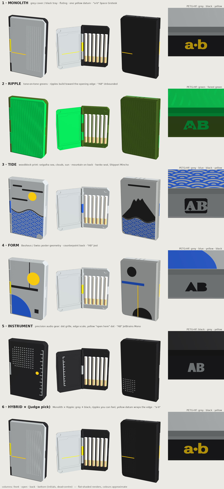

# v6: five new visual directions (concepts only, no 3MF yet)

The structure is the unchanged v5 Book: 55 × 13 × 85 mm, spine hinge, 6 channels, magnets, faceted corners. Only colour, surface graphics and typography change. Everything is in PETG-HF. The initials are 3.8–4.2 mm tall and sit dead-centre on the bottom face.

| # | Direction | Inspired by | Colours | Typeface |
|---|---|---|---|---|
| 1 | MONOLITH | h3li0 (clean, functional, lowercase "a · b" naming) | grey, black, yellow | Space Grotesk Bold |
| 2 | RIPPLE | Abstractia / dkdsgn (ribbed ripple lamps, two-tone) | green, forest green | Unbounded Black |
| 3 | TIDE | XXY2025 (pictorial ukiyo-e gift boxes); original seigaiha and mountain composition | grey, blue, black, yellow | Shippori Mincho B1 (hanko seal) |
| 4 | FORM | Bauhaus / Swiss modernist poster | grey, blue, yellow, black | Jost Black |
| 5 | INSTRUMENT | Precision audio and measuring gear | black, grey, yellow | JetBrains Mono ExtraBold |
| 6 | HYBRID ★ | Monolith × Ripple, proposed by the independent judge | grey, black, yellow | Space Grotesk Bold |

All fonts are SIL OFL licensed (Google Fonts). The 3MF is built only after a direction is approved.

## Independent judge (design-evaluation rubric, qualitative)
Ranking: Monolith > Ripple > Tide > Form > Instrument. The judge proposed the Hybrid (row 6).

Risks it flagged for the final build:
- Make yellow inlays 1.0 mm deep so a dark base doesn't show through. Already applied in the Hybrid.
- Initials at about 4 mm are at the print limit; 5–5.5 mm is safer.
- Tide's magnet clearance needs designing into the art so it doesn't read as a defect.
- Instrument's tiny first-layer dots will smear.
