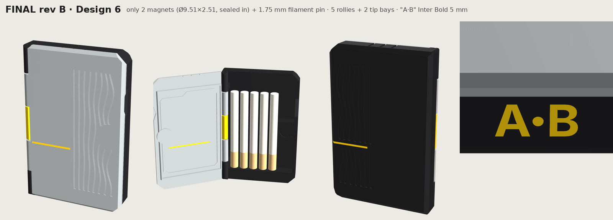

# AB Rollie Book: FINAL rev B (Design 6 "Hybrid"), SUPERSEDED by ../v7-65x15x88

**`AB_Rollie_Book_Hybrid_revB_55x13x85.3mf`**: Bambu Studio project, 1 plate, no supports, **no glue and no extra hardware**.

## The only parts you need
| Part | Qty | Notes |
|---|---|---|
| Round magnets **Ø9.51 × 2.51 mm** | 2 | Sealed inside the print during two pauses |
| **1.75 mm filament** (PETG-HF) | about 84 mm | Hinge pin |
| PETG-HF **grey / black / yellow** | AMS slots 1 / 2 / 3 | Cover / tray / inlays and spine sleeve |

## What changed from the first final
- **Closure:** one magnet pair at the **centre of the opening edge**, so the cover closes evenly in a single movement.
  - The cover has a small boss on its inner face that holds its magnet; it drops into a matching recess in the tray.
  - The magnets are **sealed in** under 0.4–0.5 mm of plastic, with walls of at least 0.8 mm around each.
  - There is 0.9 mm between the magnets when closed.
- **Capacity:** **5 rollie slots** (6.4 mm, for rollies up to 6 × 60 mm). The magnet block sits in the right-hand column, which leaves **two filter-tip bays**, one above it and one below.
- **Hinge:** a **1.75 mm filament pin**. It is a tight fit in the tray's end knuckles (Ø1.80) and loose in the cover knuckles (Ø2.0) and the sleeve (Ø2.1).
- **Thumb scoop:** moved above the magnet (z 53–67 mm).
- **Initials:** **A·B** in **Inter Bold**, a free Helvetica-class typeface (SIL OFL). 5.0 mm tall, dead-centre on the bottom, yellow 1.0 mm deep.
- **Ripples:** on the cover they part around the magnet like water around a stone. Everything else is the approved Design 6 visual.

## How to print (important: 2 pauses)
1. Open the 3MF and press **Sync AMS**. Make sure slot 1 is grey, 2 black and 3 yellow, all with **PETG HF** presets. The file inherits PLA presets from its template, and syncing replaces them.
2. Slice it. In the preview, move the layer slider and **right-click → Add pause** at these two layers:
   - **Z = 3.88 mm**: pause for the **cover** magnet.
   - **Z = 8.36 mm**: pause for the **tray** magnet.
3. **Polarity, before you print:** stick the two magnets together and mark the two faces that touch with a pen. Insert each magnet with its **marked face UP**.
4. **At each pause,** press the magnet fully into its pocket, marked face up. It's a snug fit; check it sits below the pocket rim, then resume. The printer seals it in.
5. Use the **Textured PEI** plate.

## Assembly
- Slide the yellow sleeve between the cover knuckles.
- Push the 1.75 mm filament through the knuckles from the top. Pliers help with the last bit.
- Trim the filament flush. Optionally, briefly heat the ends to flare them so the pin can't work out.

## Verification
| Check | Status |
|---|---|
| Envelope 55 × 13 × 85, single solid parts, no overlaps | PASS |
| 5 rollies clear; cover swings to 165° without contact | PASS |
| Magnet pockets: walls ≥ 0.8 mm, 0.4 mm skins, pocket tops on layer boundaries (pause Z exact) | PASS |
| 3MF: 9 watertight meshes on the bed; 3 filaments; 100% infill modifiers (hinge, end blocks, magnet zone) | PASS |
| Sliced in Bambu Studio / test print | NOT_EVALUATED |
