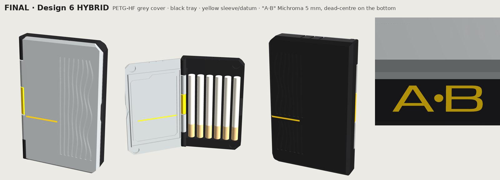

# AB Rollie Book: final (Design 6 "Hybrid")

**`AB_Rollie_Book_Hybrid_55x13x85.3mf`** is a Bambu Studio project: 1 plate, no supports.

## The design
- **Structure:** unchanged from v5. 55 × 13 × 85 mm, spine hinge, 6 channels for rollies up to 6 × 60 mm, 8.5 mm magnet end blocks, faceted opening-side corners.
- **Cover (grey):** ripple grooves that build toward the opening edge, where your thumb goes. They are stepped at 45°, so they print support-free face-down.
- **Tray (black):** the ripples mirrored on the back, at the opening side.
- **Yellow datum line:** about 32.5 mm up (golden section). It runs across the front, wraps over the opening edge onto the back, and repeats inside the cover.
- **Spine sleeve:** yellow, hexagonal, spins freely on the pin.
- **Initials:** uppercase **A·B** in **Michroma** (SIL OFL), 5.0 mm tall, dead-centre on the bottom face. Strokes are thickened 0.15 mm horizontally so they print cleanly upright.
- **Yellow depth:** all yellow inlays are **1.0 mm** deep, so a dark base won't show through.

## Filaments (load these AMS slots)
| Slot | Colour | Used for |
|---|---|---|
| 1 | PETG-HF **Grey** | Cover |
| 2 | PETG-HF **Black** | Tray |
| 3 | PETG-HF **Yellow** | Datum lines, initials, spine sleeve |

## Settings already in the file
- 0.16 mm layers, 4 walls, 50% gyroid infill, no supports.
- **100% infill and 6 walls** on the hinge and magnet blocks, applied by modifier volumes.
- Prime tower on; the purge matrix is set for grey, black and yellow.

## Before you print
1. In Bambu Studio, press **Sync AMS** so all three filaments use **PETG HF** presets. The file inherits PLA presets from its template.
2. Use the **Textured PEI** plate. It gives a matte finish and hides fingerprints on the black tray.
3. Check layer 1 in the preview: the front datum line should start on the first layers.
4. Optional: print a small test block with holes at 1.95, 2.0, 2.1 and 2.2 mm to check the hinge pin fit.

## Hardware
- 1 × 2 mm steel rod, 85 mm long. Ream the tray end knuckles with a 2.0 mm drill if it's too tight.
- 4 × 6 × 2 mm N52 magnets. Glue them with thick CA or epoxy, and check the polarity before the glue sets.

## Verification
| Check | Status |
|---|---|
| Envelope 55 × 13 × 85, single solid parts, no overlaps | PASS |
| 6 rollies clear; cover swings to 165° without contact | PASS |
| 3MF structure: 9 watertight meshes on the bed; 3 filaments; per-filament settings and the 3×3 purge matrix sized correctly; modifiers flagged | PASS |
| Sliced in Bambu Studio | NOT_EVALUATED (no slicer available in this environment) |
| Hand-feel, initials legibility, hinge and magnet fit | NOT_EVALUATED (needs a test print) |

The alternative font is in `final_font_options.png`. Swapping it is a one-line change in `src/v6_final.py` (`FONT`).

## ⚠ Open item: magnets (do not print yet)
The owner has only **2 magnets**, and their size is to be confirmed. This file has pockets for 4 × 6×2 mm magnets.

When the size arrives:
- **Default plan:** put both magnets in the tray end blocks (one at each end) and add a steel striker in each cover pocket, such as a small steel washer or disc. That keeps the closing force even at both ends.
- **Fallback (no steel parts):** one magnet pair at a single end, plus friction from the lip. This is simpler but closes unevenly.

What fits without structural change:
- **Diameter:** up to about Ø6.5 mm in the 8.5 mm end blocks.
- **Thickness:** up to about 4 mm on the tray side and about 2.1 mm in the cover plate.
- **Larger magnets:** the end blocks can grow to about 11 mm (there is about 8 mm of spare length above the 60 mm rollies), which allows about Ø9.5 mm.
