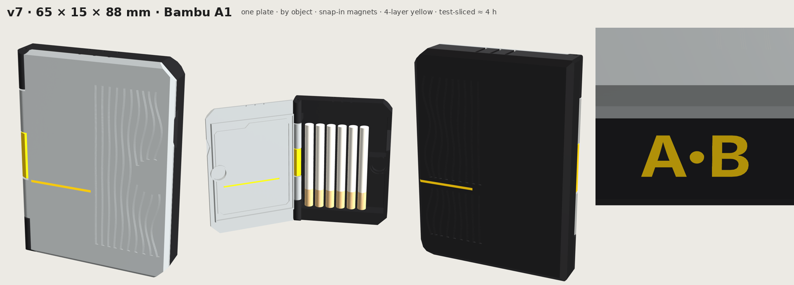

# AB Rollie Book v7: 65 × 15 × 88 mm, Bambu Lab A1 (current)

**`AB_Rollie_Book_v7_A1_by_object.3mf`**: a Bambu Studio project for the **Bambu Lab A1 + AMS lite**. It fits on **one plate**, prints **by object**, and needs no supports, glue or pauses.

## The only extra parts you need
| Part | Qty | Notes |
|---|---|---|
| Round magnets **Ø9.51 × 2.51 mm** | 2 | **Snap into** the printed pockets after printing |
| **1.75 mm filament** (PETG-HF) | ≈ 87 mm | Hinge pin |
| PETG-HF **grey / black / yellow** | AMS lite slots 1 / 2 / 3 | Cover / tray / yellow details and spine sleeve |

## Changes in this revision
- **Yellow on the outside faces is 4 layers (0.68 mm)** instead of 1.0 mm. It prints against the plate and stops well short of the grey or black body. The A·B is the same 0.68 mm deep.
- **Bambu Lab A1 profile:** built from Bambu's own system presets (Bambu Lab A1 0.4 nozzle, 0.16mm High Quality @BBL A1, Bambu PETG HF @BBL A1 ×3), resolved from the public BambuStudio repo, so the file carries the **A1's own start G-code**.
- **One plate, by object:** the cover, tray and sleeve each print completely, one after another, so the grey and black never alternate layer by layer.
  - **Spacing:** the parts sit **74 mm** apart, above the A1's 73 mm by-object clearance.
  - **Height:** every part is under the 25 mm rod height.
  - **Purge:** prime tower off; the A1 purges into its chute.
- **Snap-in magnets (no pauses):** Bambu Studio does **not** apply layer pauses in by-object mode. Its source assigns per-layer custom G-code only in by-layer printing. So the magnets now snap in after printing.
  - **Lip:** each pocket has a printed 0.4 mm lip, 0.12 mm smaller than the magnet, with 4 relief slots. Press the magnet in with your thumb until it clicks.
  - **Strength:** walls of at least 0.8 mm; 1.0 mm between the magnets when closed.

## How to print
1. Open the 3MF. Load **grey, black and yellow PETG-HF** into AMS lite slots 1, 2 and 3, then press **Sync AMS**.
2. Check that the plate shows **Print sequence: By object**. Slice and print. No pauses, no supports.
3. **Magnets:** stick the two magnets together and mark the two faces that touch. Press each magnet into its pocket **marked face OUT** (visible), so that they attract when the case closes.
4. **Hinge:** slide the yellow sleeve between the cover knuckles, then push the filament pin through from the top and trim it flush. Optionally, heat the ends briefly to flare them so the pin stays put.

## Print profile
- **Base:** Bambu's **0.16mm High Quality @BBL A1** (outer wall 60 mm/s at 2000 mm/s², default acceleration 4000).
- **Walls and shells:** 4 walls (arachne), 6 top / 5 bottom shells.
- **Infill:** 50% gyroid, with **100% infill and 6 walls** on the hinge, end blocks and magnet clasp.
- **Seam and first layer:** seam at the back (the top end of the case); elephant-foot compensation 0.15; Textured PEI plate.
- **Purge:** flush into infill on the cover and tray.

## Test slice (PrusaSlicer 2.7.2, A1 clearances and limits, sequential printing)
| | |
|---|---|
| Estimated time | **3 h 44 m**, including AMS lite load and unload (≈ 41 min of that) |
| Plus A1 purge time (not modelled) | ≈ 15–30 s per swap, so **≈ 4 to 4¼ h in total** |
| Colour swaps | 47. Most of them come from the A·B on the bottom, which stands upright in print |
| Filament in the parts | ≈ 19.5 g grey, 36.6 g black, 0.6 g yellow (purge goes to the chute and adds ≈ 15–20 g) |
| Result | Slices cleanly with sequential clearance satisfied. "Long bridging" warning: benign internal bridges |

Reproduce it with `prusa-slicer --export-gcode --load test-slice/a1_hq_petghf_0.16.ini test-slice/a1_one_plate.3mf`.

## Verification
| Check | Status |
|---|---|
| Envelope 65 × 15 × 88, single solid parts, no overlaps | PASS |
| 6 rollies clear; cover swings to 165° without contact | PASS |
| Magnet pockets: walls ≥ 0.8 mm, slotted snap lips present | PASS |
| 3MF: 9 watertight meshes on the bed, 1 plate, A1 printer/process/filament presets, by object, no prime tower | PASS (structure) |
| By-object clearances: gaps ≥ 73 mm, heights < 25 mm | PASS (layout and PrusaSlicer sequential slice) |
| Opened in Bambu Studio / test print | NOT_EVALUATED |

`superseded/` holds the earlier P1S three-plate file, which sealed the magnets in with pauses.
