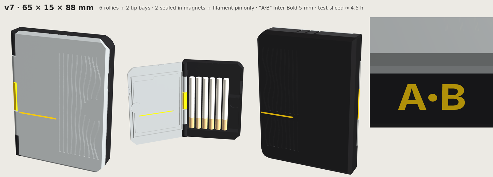

# AB Rollie Book v7: 65 × 15 × 88 mm (current)

**`AB_Rollie_Book_v7_65x15x88.3mf`** is a Bambu Studio project with **3 plates**, no supports and no glue.

## Why 88 mm (not 85)
- **Proportion:** 65 × 88 (ratio 1.354) is marginally closer to a classic 3:4 rectangle than 65 × 85 (1.308), and reads less squat in the hand.
- **Strength:** the extra 3 mm goes into thicker end blocks (9 mm).
- **Finger room:** about 10 mm of space above the 60 mm rollies.

## What's in it
- **Capacity:** 6 rollie slots (6.6 mm, rollies up to 6 × 60 mm) plus **2 filter-tip bays**, one above and one below the magnet clasp.
- **Closure:** a single sealed-in magnet pair centred on the opening edge (Ø9.51 × 2.51 mm).
  - 0.98 mm gap between the magnets when closed.
  - Walls of at least 0.8 mm around each magnet.
- **Hinge:** 1.75 mm filament pin. Tight in the tray end knuckles (Ø1.80), loose in the cover knuckles (Ø2.0) and the sleeve (Ø2.1). Hinge knuckles are R 2.8.
- **Walls:** 3.0 mm cover plate, 2.6 mm tray back and sides, 6 mm × 45° corner facets.
- **Look (Design 6):** grey cover with ripples toward the opening edge (parting around the magnet), black tray, yellow golden-section datum line (wraps the edge and repeats inside), yellow hex sleeve.
- **Initials:** **A·B** in Inter Bold, 5 mm tall, dead-centre on the bottom.

## Plates
| Plate | Colours (AMS slots) | Pause | Notes |
|---|---|---|---|
| 1: Cover | grey (1) + yellow (3) | **Z 4.04 mm**: insert cover magnet, marked face UP | Face-down |
| 2: Tray | black (2) + yellow (3) | **Z 10.12 mm**: insert tray magnet, marked face UP | Back-down |
| 3: Spine sleeve | yellow (3) | none | Standing |

The pauses are embedded in the file (`Metadata/custom_gcode_per_layer.xml`). If Bambu Studio doesn't show them on the layer slider, right-click those layers and choose **Add pause**.

**Polarity:** stick the two magnets together and mark the faces that touch. Insert both with the marked face up.

## Print profile (already set): quality-first, sensible time
- **Layers:** 0.16 mm (first layer 0.2).
- **Walls and shells:** 4 walls (arachne), 6 top / 5 bottom shells.
- **Infill:** 50% gyroid, plus **100% infill and 6 walls** on the hinge, end blocks and magnet clasp.
- **Quality speeds:** outer wall 80 mm/s at 3000 mm/s² acceleration; top surface 100 mm/s.
- **Seam and first layer:** seam at the back (the top end of the case); elephant-foot compensation 0.15.
- **Purge:** prime tower on; **flush into infill** on the cover and tray, so most of the purge is hidden inside the parts.

## Test slice (PrusaSlicer 2.7.2, P1S-like profile, 3-filament wipe tower)
This is not Bambu Studio, but it uses the same geometry and layer scheme. Reproduce it from `test-slice/` with `prusa-slicer --export-gcode --load p1s_petghf_0.16.ini plate2_tray.3mf`.

| Plate | Est. time | Colour swaps | Filament (incl. purge) |
|---|---|---|---|
| 1 Cover | 1 h 17 m | 12 | 21.7 g grey, 2.5 g yellow |
| 2 Tray | 3 h 10 m | 40 | 43.5 g black, 12.2 g yellow |
| 3 Sleeve | 6 m | 1 | 0.5 g yellow |
| **Total** | **≈ 4 h 33 m** | **53** | **≈ 80 g** |

- **Layer height:** at 0.12 mm the total is ≈ 6 h 02 m (+33%) and only the 15 mm side walls look better, so 0.16 mm was chosen.
- **Layer boundaries:** both magnet pocket tops fall exactly on sliced layers (3.88 and 9.96 mm). Each pause sits at the start of the following layer (4.04 and 10.12 mm), verified in the G-code.
- **"Long bridging" warning:** benign. It comes from internal bridges over sparse infill and from the 0.6 mm groove ceilings. The 9.7 mm skins over the magnets are held up by the magnets themselves.
- **Where the swap time goes:** the vertical-in-print A·B costs about 31 of the tray's 40 swaps (≈ 35 min). Moving it to the back face would make it nearly free.
- **Estimate accuracy:** PrusaSlicer models the motion and swap times (35 + 35 s per swap) approximately. Expect Bambu Studio's estimate to differ by ±20–30%.

## Verification
| Check | Status |
|---|---|
| Envelope 65 × 15 × 88, single solid parts, no overlaps | PASS |
| 6 rollies clear; cover swings to 165° without contact | PASS |
| Magnet pockets: walls ≥ 0.8 mm; skins 0.4 mm; pause Z on layer boundaries | PASS (geometry and slice) |
| Bambu 3MF: 9 watertight meshes on the bed, 3 plates, 3 filaments, modifiers, pauses | PASS (structure) |
| Slices without errors | PASS (PrusaSlicer) |
| Opened in Bambu Studio / test print | NOT_EVALUATED |
